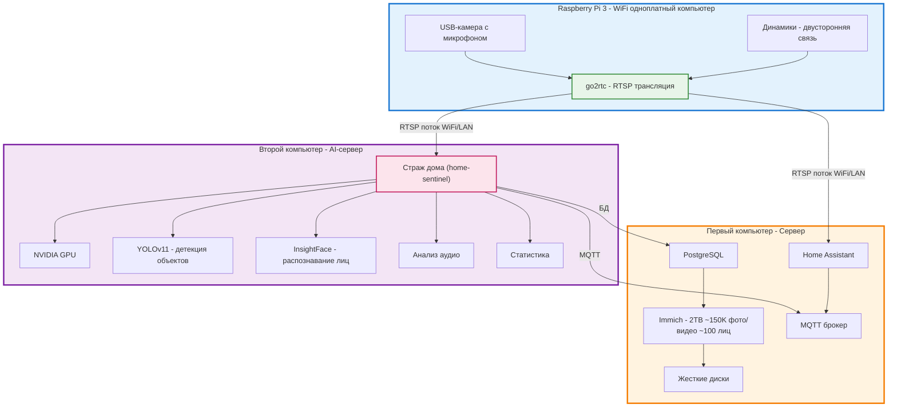
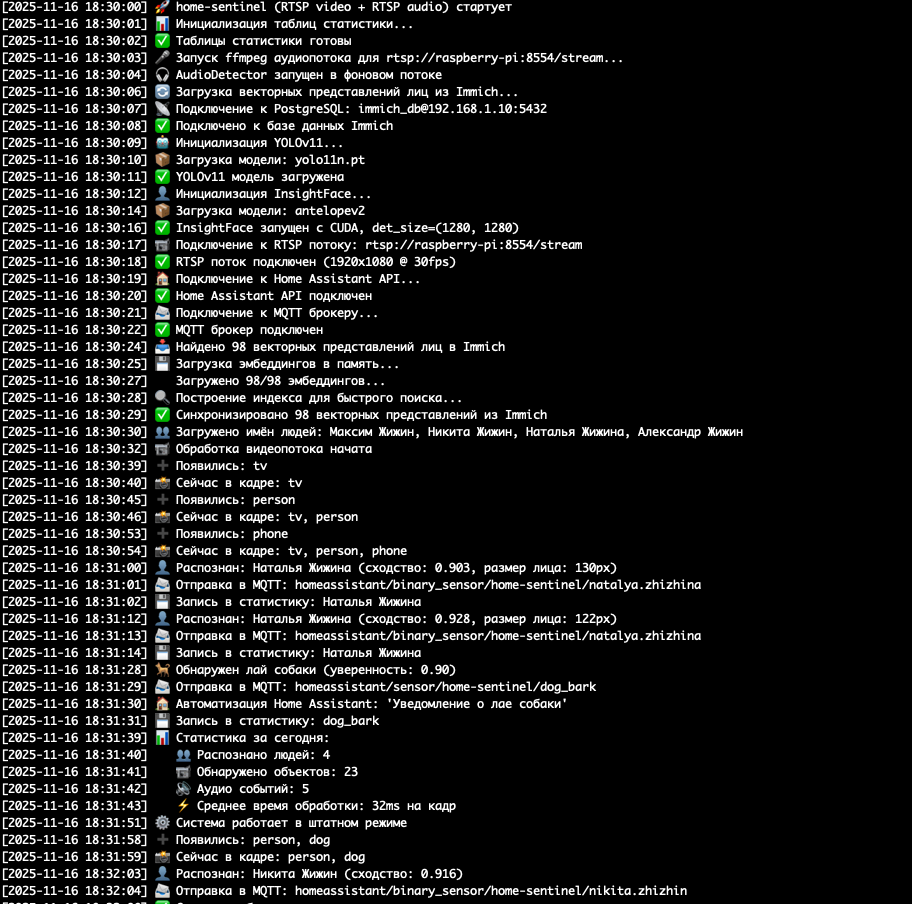

# {PROJECT_TITLE}
Автор: {AUTHOR_FULL_NAME}, 
{AUTHOR_CLASS} класс {AUTHOR_SCHOOL}
{CONFERENCE_CITY} {CONFERENCE_YEAR}

---

# О проекте

Страж дома (рабочее название приложения home-sentinel) — это умная система для дома, которая помогает автоматизировать многие процессы. Что особенно интересно — вся эта сложная система собрана из самых обычных, подручных средств, которые можно найти дома или купить недорого. Для создания системы использовались:

- Простая USB-камера с микрофоном (такая же, как для видеозвонков)
- Устаревшая модель Raspberry Pi 3 (уже не самая новая, но отлично работает)
- Обычные компьютерные колонки
- Обычная игровая видеокарта (не профессиональная, а та, что используется для игр)

Несмотря на простоту оборудования, система умеет:

- Узнавать членов семьи по лицу
- Находить объекты на видео в реальном времени
- Распознавать звуки (речь, стук в дверь, лай собаки)
- Ведет статистику того, что происходит дома
- Работает вместе с другими системами умного дома

Система использует современные технологии искусственного интеллекта и видеокарту для быстрой обработки данных.

---

# Как устроена система

Система состоит из трех частей, каждая из которых делает свою работу:

---

# Из чего состоит система

## Home Assistant

Home Assistant — это программа, которая управляет умным домом. Представьте, что это "мозг" вашего дома.

**Что она умеет:**
- Управлять всеми устройствами умного дома из одного места
- Создавать автоматические сценарии (например, включать свет, когда кто-то приходит)
- Работать с тысячами разных устройств
- Показывать все на веб-странице или в мобильном приложении
- Обмениваться данными с другими системами

**Как мы используем:**
- Страж дома отправляет информацию о том, что происходит, в Home Assistant
- Home Assistant может автоматически что-то делать, когда система узнает человека
- Например, когда система узнает маму, она может включить свет в прихожей

---

## go2rtc

go2rtc — это программа, которая передает видео и звук по сети. Это как телевизионная трансляция, только для компьютеров.

**Что она делает:**
- Берет видео и звук с камеры
- Передает их по сети в специальном формате
- Работает с разными камерами и устройствами
- Передает данные почти без задержки
- Может передавать и видео, и звук одновременно

**В нашей системе:**
- Установлена на маленьком компьютере Raspberry Pi 3 (это устаревшая модель, но она отлично справляется с задачей)
- Получает видео и звук с простой USB-камеры (такой же, как для видеозвонков)
- Передает их по WiFi или кабелю в другие части системы
- Страж дома и Home Assistant подключаются к этому потоку

**Двусторонняя связь:**
- На Raspberry Pi 3 подключены обычные компьютерные колонки
- Через них можно не только слушать, но и говорить
- Это позволяет общаться через систему

---

## Immich

Immich — это программа для хранения и организации фотографий и видео. Она умеет распознавать лица на фотографиях.

**Что она умеет:**
- Автоматически загружать и сортировать фотографии
- Узнавать людей на фотографиях с помощью искусственного интеллекта
- Создавать альбомы по людям
- Искать фотографии по лицам, объектам или местам
- Показывать все через веб-страницу
- Работать на телефонах iPhone и Android
- Делать резервные копии

**Что у нас хранится:**
- Всего данных: 2 Терабайта (это очень много!)
- Фотографий и видео: примерно 150 тысяч
- Период: вся история нашей семьи
- Распознанных лиц: около 100 человек с именами
- База данных: PostgreSQL, где хранятся "отпечатки" лиц

**Как мы используем:**
- Страж дома берет информацию о лицах из Immich
- Имена людей тоже берутся оттуда
- Не нужно создавать отдельную базу данных
- Используем то, что уже есть
- Все обновляется автоматически

---

## PostgreSQL

PostgreSQL — это база данных, то есть место, где хранится вся информация.

**Что там хранится:**
- Все данные Immich (информация о фотографиях, где они лежат)
- Списки людей
- "Отпечатки" лиц (специальные числа, которые описывают лицо)
- Связи между лицами и фотографиями
- Все это нужно для быстрого поиска

**Как Страж дома использует:**
- Загружает "отпечатки" лиц из базы данных Immich
- Сохраняет их у себя для быстрого доступа
- Записывает статистику в свою отдельную базу данных

---

## Страж дома

Страж дома — это главная программа, которая анализирует видео и звук. Она работает на обычной игровой видеокарте (не профессиональной, а той, что используется для компьютерных игр), и этого вполне достаточно для всех вычислений.

**YOLOv11 (You Only Look Once):**
- Находит объекты на видео в реальном времени
- Может найти людей, животных, предметы
- Работает очень быстро благодаря обычной игровой видеокарте
- Используем упрощенную версию модели для баланса скорости и точности

**InsightFace:**
- Узнает и сравнивает лица
- Использует ту же модель, что и Immich
- Создает "отпечаток" лица (набор чисел)
- Сравнивает с базой лиц из Immich

**Анализ звука:**
- Распознает звуки (речь, стук в дверь, лай собаки)
- Работает со звуком, который приходит по сети
- Записывает, какие звуки были обнаружены

**Статистика:**
- Записывает, кто появлялся в кадре
- Записывает, какие звуки были услышаны
- Хранит все в отдельной базе данных
- Можно потом посмотреть и проанализировать

**Связь через MQTT:**
- Отправляет статистику и события в Home Assistant
- Сообщает о важных событиях (собачий лай, стук в дверь)
- Сообщает, когда узнает людей
- Все это уже работает

---

## MQTT

MQTT — это способ обмена сообщениями между устройствами. Это как почта, только для умных устройств.

**Как мы используем:**
- Страж дома отправляет информацию в Home Assistant
- Уже работает отправка уведомлений о событиях:
  - Собачий лай
  - Стук в дверь
  - Распознавание людей
- Home Assistant получает эти сообщения и может что-то делать автоматически
- Сообщения доставляются надежно

---

# Как работает система

1. **Камера записывает видео и звук**
   - USB-камера с микрофоном на Raspberry Pi 3 записывает все, что происходит
   - Программа go2rtc передает это по сети
   - Видео и звук идут в реальном времени
   - Передача идет по WiFi или кабелю

2. **Видео и звук распределяются**
   - **В Home Assistant** — чтобы показывать видео на экране умного дома
   - **В Страж дома** — чтобы анализировать с помощью искусственного интеллекта

3. **Страж дома обрабатывает данные**
   - Получает кадры видео и звук
   - YOLOv11 смотрит каждый кадр
   - Находит объекты (человек, собака, телевизор, кровать и т.д.)

4. **Если найден человек:**
   - InsightFace создает "отпечаток" лица
   - Сравнивает с базой из Immich
   - Определяет имя человека, если находит похожее лицо

5. **Анализ звука:**
   - Распознает звуки в реальном времени (собачий лай, стук в дверь)
   - Записывает в статистику, когда что-то обнаружено

6. **Результаты отправляются:**
   - Статистика и события идут в Home Assistant
   - Уведомления о важных событиях
   - События распознавания людей
   - Все также записывается в базу данных для статистики

---

# Какие технологии используются

**Основные программы:**
- Python 3.10 — язык программирования
- PyTorch — библиотека для работы с искусственным интеллектом, использует видеокарту
- OpenCV — библиотека для обработки видео
- NumPy — библиотека для математических вычислений

**Искусственный интеллект:**
- YOLOv11 — находит объекты на изображениях
- InsightFace — узнает лица
- CUDA — использует видеокарту для ускорения вычислений

**Инфраструктура:**
- Docker и Docker Compose — для запуска программ в контейнерах
- PostgreSQL — база данных
- RTSP — протокол для передачи видео и звука

**Интеграции:**
- Home Assistant API — для связи с системой умного дома
- Immich API — для связи с программой хранения фотографий
- PostgreSQL — для работы с базой данных
- MQTT — для отправки сообщений между устройствами

---

# Почему система сделана именно так

Важно отметить, что вся система собрана из подручных средств. Не нужно покупать дорогое профессиональное оборудование — все работает на том, что есть дома или можно купить недорого.

- **Разделение работы:**
  - Raspberry Pi 3 (устаревшая модель): записывает видео и звук с простой USB-камеры, передает по сети
  - Первый ПК: хранит данные, фотографии, управляет умным домом
  - Второй ПК: делает вычисления с помощью обычной игровой видеокарты

- **Можно расширять:**
  - Можно добавить больше компьютеров для вычислений
  - Можно добавить больше камер

- **Эффективность:**
  - Видеокарта используется только для задач искусственного интеллекта
  - Фотографии и видео хранятся на сервере с большими дисками

- **Надежность:**
  - Каждая часть работает отдельно
  - Если одна часть сломается, остальные продолжают работать

- **Используем то, что уже есть:**
  - Immich уже содержит базу лиц
  - Home Assistant уже настроен
  - Не нужно создавать все заново

---

# Статистика и мониторинг

Страж дома записывает статистику:

**Появление людей:**
- Кто появился в кадре
- Когда это произошло
- Как часто это происходит

**Обнаруженные звуки:**
- Какой звук был (речь, лай собаки)
- Когда он был обнаружен
- Как часто это происходит

**Данные хранятся в отдельной базе данных Страж дома для:**
- Анализа активности
- Создания отчетов
- Хранения истории

**Отправка через MQTT:**
- Статистика и события отправляются в Home Assistant
- Уведомления о событиях (собачий лай, стук в дверь) уже работают
- Home Assistant может автоматически что-то делать на основе событий

---

# Заключение

Страж дома — это умная система, которая:

- Использует то, что уже есть (Immich, Home Assistant)
- Эффективно использует ресурсы (видеокарта на отдельном компьютере)
- Узнает людей в реальном времени
- Ведет статистику и работает вместе с умным домом
- Легко устанавливается и может расширяться

Система готова к использованию и может быть дополнена новыми функциями (голосовое управление, синтез речи и т.д.)
