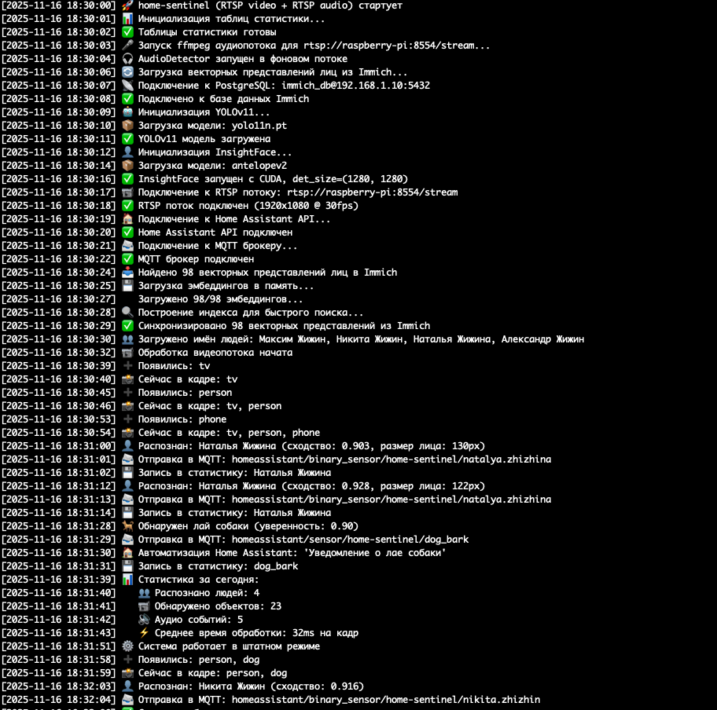

{CONFERENCE_DEPARTMENT}
{CONFERENCE_ORGANIZATION}
{CONFERENCE_NAME}

Секция: {CONFERENCE_SECTION}

**Тема: {PROJECT_TITLE}**

Автор:
**{AUTHOR_FULL_NAME},**
{AUTHOR_CLASS} класс {AUTHOR_SCHOOL}
{AUTHOR_DISTRICT} округа
города Новосибирска

Научный руководитель:
**{SUPERVISOR_FULL_NAME},**
{SUPERVISOR_POSITION}
{SUPERVISOR_DEGREE}{SUPERVISOR_DEGREE_SPACE}
конт. тел. {AUTHOR_PHONE}

{CONFERENCE_CITY} {CONFERENCE_YEAR}

---

# Аннотация

В работе представлена система Страж дома (рабочее название приложения home-sentinel) — умная система для мониторинга и распознавания в умном доме. Система умеет узнавать членов семьи по лицу в реальном времени, находить объекты на видео, анализировать звуки и вести статистику активности.

Особенность проекта в том, что вся эта сложная система собрана из самых обычных, подручных средств: простая USB-камера (такая же, как для видеозвонков), устаревшая модель Raspberry Pi 3, обычные компьютерные колонки и обычная игровая видеокарта. Несмотря на простоту оборудования, система работает эффективно.

Система состоит из трех частей: маленького компьютера Raspberry Pi 3 для записи видео и звука, сервера для хранения данных и компьютера с видеокартой для вычислений. Система работает вместе с уже существующими программами (Home Assistant, Immich) и использует современные технологии искусственного интеллекта.

---

<!-- TOC -->

---

# Введение

## Актуальность темы

В наше время системы умного дома становятся все более популярными. Одна из важных задач таких систем — узнавать людей и находить объекты в реальном времени, чтобы автоматически что-то делать. Существующие решения часто сложно настроить и они не работают вместе с тем, что уже есть дома.

## Новизна подхода

Новизна работы в том, что создана умная система, которая объединяет распознавание лиц, поиск объектов и анализ звука. При этом система использует то, что уже есть (Immich для базы лиц, Home Assistant для автоматизации), не нужно создавать все заново.

Особенно важно, что вся система собрана из подручных средств: простая USB-камера, устаревшая модель Raspberry Pi 3, обычные компьютерные колонки и обычная игровая видеокарта. Это показывает, что для создания сложной системы не обязательно покупать дорогое профессиональное оборудование.

## Объект и предмет исследования

Объект исследования — системы мониторинга и распознавания для умного дома.

Предмет исследования — способы узнавания лиц и поиска объектов в реальном времени с помощью искусственного интеллекта.

## Цель работы

Создать систему Страж дома для умного мониторинга и распознавания в умном доме, которая работает вместе с уже существующими системами.

## Задачи исследования

1. Изучить существующие решения для распознавания лиц и поиска объектов в умном доме
2. Разработать архитектуру системы с разделением работы между сервером и компьютером для вычислений
3. Сделать так, чтобы система работала вместе с Home Assistant и Immich
4. Реализовать алгоритмы распознавания лиц с помощью InsightFace
5. Реализовать поиск объектов с помощью YOLOv11
6. Использовать видеокарту для ускорения вычислений
7. Создать систему статистики и мониторинга

## Методы исследования

- Изучение научной литературы о способах распознавания лиц и поиска объектов
- Проектирование архитектуры системы с учетом того, как быстро она должна работать
- Программирование на Python с использованием библиотек для искусственного интеллекта (PyTorch, OpenCV)
- Тестирование и улучшение работы системы

---

# Глава 1. Обзор научной литературы и существующих решений

## 1.1. Способы поиска объектов в реальном времени

Поиск объектов в реальном времени — это одна из важных задач компьютерного зрения. Один из самых эффективных способов — это семейство алгоритмов YOLO (You Only Look Once), предложенное Redmon и Farhadi [1]. YOLO делит изображение на части и для каждой части предсказывает, где находятся объекты и что это за объекты. Это позволяет обрабатывать изображения очень быстро.

Более новые версии YOLO, включая YOLOv7 [2], стали еще точнее и быстрее благодаря новым способам обучения нейронных сетей. YOLOv11, который используется в этой работе, — это дальнейшее развитие этого подхода, оптимизированное для работы на видеокарте.

## 1.2. Способы распознавания лиц

Распознавание лиц с помощью глубокого обучения показало большие успехи в последние годы. InsightFace — это один из современных инструментов для распознавания лиц, который использует нейронные сети для создания "отпечатков" лиц [3, 4].

Основная идея в том, что лица превращаются в наборы чисел (векторы) в специальном пространстве. Сравнение лиц происходит путем вычисления похожести между этими наборами чисел. Это позволяет эффективно узнавать людей даже при разном освещении и разных углах съемки.

## 1.3. Интеграция систем умного дома

Современные системы умного дома, такие как Home Assistant [7], предоставляют открытые интерфейсы для подключения разных компонентов. Это позволяет создавать модульные системы, где каждая часть может быть сделана отдельно и подключена через стандартные интерфейсы.

## 1.4. Использование видеокарты для ускорения вычислений

Использование видеокарты для ускорения вычислений искусственного интеллекта стало стандартом в современных системах. CUDA [11] предоставляет платформу для параллельных вычислений на видеокарте, что позволяет значительно ускорить обработку видео в реальном времени. Важно отметить, что для этого не обязательно нужна дорогая профессиональная видеокарта — обычная игровая видеокарта отлично справляется с задачей.

---

# Глава 2. Разработка и реализация системы Страж дома

## 2.1. Архитектура системы

Система Страж дома построена так, что работа разделена между тремя частями, каждая из которых делает свою задачу. Такой подход позволяет эффективно использовать ресурсы и легко расширять систему.

Особенность проекта в том, что вся система собрана из подручных средств. Не нужно покупать дорогое профессиональное оборудование — все работает на том, что можно найти дома или купить недорого.

## 2.1.1. Raspberry Pi 3 (Маленький компьютер)

Raspberry Pi 3 с поддержкой WiFi записывает видео и звук, а также обеспечивает двустороннюю связь. Это устаревшая модель, но она отлично справляется с задачей. На нем установлены следующие компоненты:

- **USB-камера с микрофоном**: Простая камера, такая же, как для видеозвонков. Обеспечивает видео и звук для анализа
- **Динамики**: Обычные компьютерные колонки. Используются для двусторонней связи
- **go2rtc**: Программа для передачи видео и звука по сети. Доступ по сети: rtsp://raspberry-pi:8554/stream

## 2.1.2. Первый компьютер (Сервер)

Первый компьютер хранит данные и управляет умным домом. На нем установлены следующие компоненты:

- **Home Assistant**: Главная система управления умным домом. Работает с датчиками, выключателями, устройствами. Создает автоматизации и сценарии
- **Immich**: Программа для хранения фотографий и видео для семьи. 2 Терабайта данных, примерно 150,000 фотографий и видео, примерно 100 распознанных лиц с именами в формате "Имя Фамилия". Узнает лица и создает альбомы. Веб-интерфейс для просмотра
- **PostgreSQL**: База данных для Immich. Хранит информацию о файлах, "отпечатки" лиц. Информация о людях и распознанных лицах
- **MQTT брокер**: Обеспечивает доставку событий и статистики от Страж дома в Home Assistant
- **Жесткие диски**: Хранение фотографий и видео Immich. Резервное копирование

## 2.1.3. Второй компьютер (Компьютер для вычислений)

Второй компьютер оснащен обычной игровой видеокартой NVIDIA GPU и предназначен для выполнения вычислений искусственного интеллекта. На нем запущен сервис Страж дома (home-sentinel), который включает:

- **NVIDIA GPU**: Обычная игровая видеокарта (не профессиональная). Ускоряет вычисления искусственного интеллекта. Поддержка CUDA
- **Страж дома (home-sentinel)**: YOLOv11 - поиск объектов. InsightFace - распознавание лиц. Анализ звука. Статистика и логирование

Подключения компьютера для вычислений:

- RTSP поток с Raspberry Pi 3 (go2rtc)
- PostgreSQL (база данных Immich)
- Home Assistant API
- MQTT брокер (для доставки событий и статистики)
- Immich API (опционально)

## 2.2. Компоненты системы

### 2.2.1. Home Assistant

Home Assistant [7] — это открытая платформа для автоматизации умного дома. Основные функции: управление всеми устройствами умного дома из одного места, создание автоматизаций и сценариев, работа с тысячами устройств и сервисов, веб-интерфейс и мобильные приложения, поддержка MQTT, REST API, WebSocket.

В нашей системе Страж дома отправляет события в Home Assistant через MQTT и REST API, что позволяет запускать автоматизации на основе распознавания людей. Например, можно включить свет, когда система узнает конкретного человека.

### 2.2.2. go2rtc

go2rtc — это легкая программа для передачи видео и звука. Функции: преобразование разных источников в RTSP поток, поддержка USB-камер, IP-камер, файлов, низкая задержка передачи, поддержка звука и видео одновременно.

В нашей системе go2rtc установлен на Raspberry Pi 3 (устаревшая модель, но работает отлично), получает видео и звук с простой USB-камеры с микрофоном, передает в RTSP формат по сети (WiFi/LAN). Обычные компьютерные колонки на Raspberry Pi 3 используются для обратного канала связи, что позволяет общаться через систему.

### 2.2.3. MQTT

MQTT (Message Queuing Telemetry Transport) — это легкий протокол обмена сообщениями для умных устройств. В нашей системе MQTT используется для доставки статистики и событий от Страж дома в Home Assistant. Уже работает доставка уведомлений о событиях: собачий лай, стук в дверь, распознавание людей. Home Assistant получает события через MQTT и может запускать автоматизации. Обеспечивается надежная доставка сообщений с поддержкой QoS.

### 2.2.4. Immich

Immich [8] — это современная программа для хранения фотографий и видео с функциями искусственного интеллекта. Основные возможности: автоматическая загрузка и организация фотографий, распознавание лиц с помощью искусственного интеллекта (InsightFace), создание альбомов по людям, поиск по лицам, объектам, местам, веб-интерфейс для просмотра, мобильные приложения для iOS и Android, резервное копирование и синхронизация.

Наша конфигурация: объем данных — 2 Терабайта, количество фотографий и видео — примерно 150,000, период — вся история семьи, распознанные лица — примерно 100 человек с именами в формате "Имя Фамилия", база данных — PostgreSQL с "отпечатками" лиц.

Интеграция со Страж дома: Страж дома использует "отпечатки" лиц из Immich через прямое подключение к базе данных PostgreSQL, имена людей (в формате "Имя Фамилия") также загружаются из Immich, не нужно создавать отдельную базу данных лиц, используется уже распознанная и размеченная информация, синхронизация происходит автоматически.

### 2.2.5. PostgreSQL

PostgreSQL [9] — это мощная база данных с открытым исходным кодом. В нашей системе хранит все данные Immich (информация о файлах, пути к файлам), содержит таблицы с информацией о людях, хранит "отпечатки" лиц (512 чисел, которые описывают лицо), таблица asset_face связывает лица с фотографиями, таблица face_search содержит "отпечатки" для быстрого поиска.

### 2.2.6. Страж дома

Страж дома — это программа для анализа видео и звука. Компоненты системы:

**YOLOv11 (You Only Look Once)** [1, 2]: поиск объектов в реальном времени, обнаружение людей, животных, предметов, высокая скорость обработки благодаря обычной игровой видеокарте, модель yolo11n.pt (упрощенная версия для баланса скорости и точности).

**InsightFace** [3, 4]: распознавание и сравнение лиц, использует модель antelopev2 (совместима с Immich), создание "отпечатков" лиц (512 чисел), сравнение с базой лиц из Immich.

**Анализ звука**: распознавание звуков (речь, стук в дверь, лай собаки), поддержка RTSP звуковых потоков, статистика обнаруженных звуков.

**Статистика**: запись фактов появления людей, запись обнаруженных звуков, отдельная база данных для статистики, возможность анализа активности.

**Интеграция через MQTT**: доставка статистики и событий в Home Assistant, уведомления о событиях (собачий лай, стук в дверь), события распознавания людей, уже работает.

## 2.3. Технологический стек

### 2.3.1. Backend

- Python 3.10
- PyTorch [6] (ускорение на видеокарте)
- OpenCV [5] (обработка видео)
- NumPy (математические операции)

### 2.3.2. AI/ML

- YOLOv11 (ultralytics) - поиск объектов [1, 2]
- InsightFace - распознавание лиц [3, 4]
- CUDA [11] - вычисления на видеокарте

### 2.3.3. Инфраструктура

- Docker [10] & Docker Compose
- PostgreSQL [9]
- RTSP протокол

### 2.3.4. Интеграции

- Home Assistant API [7]
- Immich API [8]
- PostgreSQL (psycopg2) [9]
- MQTT (доставка событий и статистики)

## 2.4. Поток данных

Обработка данных в системе Страж дома происходит следующим образом:

1. Простая USB-камера с микрофоном (Raspberry Pi 3) → go2rtc → RTSP поток (видео и звук в реальном времени, передача по WiFi/LAN)
2. RTSP поток распределяется:
   - **В Home Assistant** — для отображения видео с камер в панелях умного дома
   - **В Страж дома** — для обработки с помощью искусственного интеллекта
3. Страж дома обрабатывает поток: получает кадры видео и звук, YOLOv11 [1, 2] анализирует каждый кадр и находит объекты (person, dog, tv, bed и т.д.)
4. Для каждого найденного "person": InsightFace [3, 4] создает "отпечаток" лица, сравнивает с базой из Immich, определяет имя человека (если похожесть больше порога)
5. Анализ звука: распознавание звуков в реальном времени (собачий лай, стук в дверь), запись в статистику при обнаружении
6. Результаты отправляются через MQTT: статистика и события в Home Assistant, уведомления о событиях (собачий лай, стук в дверь), события распознавания людей. Данные также записываются в базу данных статистики и логи (для отладки и мониторинга)

## 2.5. Реализация системы

### 2.5.1. Структура проекта

Проект организован следующим образом:

- code/ - код программы (main.py, models.py, embeddings.py, camera.py, audio_detector.py, database.py, stats.py)
- data/ - данные (cache/ для кэшей "отпечатков" лиц, models/ для моделей машинного обучения)
- docker-compose.yml - конфигурация Docker Compose [10]
- scripts/deploy.sh - скрипт установки
- scripts/setup-host.sh - настройка компьютера

### 2.5.2. Ключевые алгоритмы

#### Распознавание лиц

Алгоритм распознавания лиц использует следующие этапы: поиск лица с помощью InsightFace [3, 4], создание "отпечатка" лица (512 чисел), нормализация (приведение к единому виду), сравнение с базой "отпечатков" из Immich [8], вычисление похожести, применение порога в зависимости от размера лица, проверка минимальной разницы между лучшим и вторым результатом.

#### Анти-дребезг

Для стабилизации поиска объектов используется алгоритм анти-дребезга: отслеживание объектов в течение нескольких кадров, минимальное количество стабильных кадров для регистрации объекта (MIN_STABLE), максимальное количество пропущенных кадров перед удалением (MAX_MISSING), постепенное уменьшение стабильности при пропуске кадров.

## 2.6. Результаты реализации

В результате реализации проекта была создана система Страж дома, которая:

- Успешно узнает членов семьи по лицу в реальном времени с использованием InsightFace [3, 4]
- Находит объекты на видео с высокой точностью с использованием YOLOv11 [1, 2]
- Анализирует звуковые потоки для обнаружения звуков
- Ведет статистику активности и работает вместе с Home Assistant [7]
- Использует существующую инфраструктуру (Immich [8], Home Assistant [7])
- Эффективно использует обычную игровую видеокарту для ускорения вычислений с помощью CUDA [11]

### 2.6.1. Преимущества архитектуры

- Разделение работы: Raspberry Pi 3 (устаревшая модель) для записи видео/звука, первый ПК для хранения данных и управления, второй ПК для вычислений на обычной игровой видеокарте для системы Страж дома
- Масштабируемость: возможность добавления больше компьютеров для вычислений и камер
- Эффективность: обычная игровая видеокарта используется только для задач искусственного интеллекта
- Надежность: компоненты изолированы, при сбое одного остальные работают
- Использование существующей инфраструктуры: не нужно дублировать данные
- Гибкость размещения: Raspberry Pi 3 может быть размещен в любом месте благодаря WiFi
- Доступность: вся система собрана из подручных средств (простая USB-камера, устаревшая модель Raspberry Pi 3, обычные компьютерные колонки, обычная игровая видеокарта), что показывает, что для создания сложной системы не обязательно покупать дорогое оборудование

---

# Заключение

В результате проведенного исследования была разработана и реализована система Страж дома для умного мониторинга и распознавания в умном доме.

## Выводы

1. Разработана архитектура системы Страж дома с разделением работы между тремя компонентами (Raspberry Pi 3 устаревшей модели, сервер, компьютер для вычислений с обычной игровой видеокартой), что обеспечивает эффективное использование ресурсов.

2. Реализована интеграция с существующими системами умного дома (Home Assistant [7], Immich [8]) через MQTT и REST API, что позволяет использовать уже имеющуюся инфраструктуру без необходимости дублирования данных.

3. Реализованы алгоритмы распознавания лиц с использованием InsightFace [3, 4] и поиска объектов с использованием YOLOv11 [1, 2], обеспечивающие высокую точность и скорость обработки.

4. Обеспечено эффективное использование обычной игровой видеокарты для ускорения вычислений с помощью CUDA [11], что позволяет обрабатывать видеопотоки в реальном времени.

5. Реализована система статистики и мониторинга активности с доставкой событий через MQTT, обеспечивающая возможность анализа и автоматизации на основе распознавания.

6. Система успешно узнает членов семьи по лицу в реальном времени и находит объекты с высокой точностью, подтверждая эффективность выбранных методов и алгоритмов.

7. Показано, что сложная многофункциональная система может быть собрана из подручных средств: простая USB-камера, устаревшая модель Raspberry Pi 3, обычные компьютерные колонки, обычная игровая видеокарта. Это демонстрирует, что для создания эффективной системы умного дома не обязательно использовать дорогое профессиональное оборудование.

## Практические рекомендации

Система Страж дома готова к использованию в реальных условиях умного дома. Для установки необходимо:

- Настроить Raspberry Pi 3 (можно использовать устаревшую модель) с простой USB-камерой, микрофоном, обычными компьютерными колонками, go2rtc и WiFi
- Настроить сервер с Home Assistant, Immich, PostgreSQL и MQTT брокером
- Настроить компьютер для вычислений с обычной игровой видеокартой NVIDIA GPU и Docker
- Выполнить установку системы согласно инструкциям

## Перспективы дальнейшего развития

Система может быть расширена дополнительными функциями:

- Голосовое управление и синтез речи (TTS)
- Интеграция с другими системами умного дома
- Поддержка множественных видеопотоков
- Расширенная аналитика и отчетность
- Мобильное приложение для мониторинга

---

# Список литературы

1. Redmon, J., & Farhadi, A. (2018). YOLOv3: An Incremental Improvement. arXiv preprint arXiv:1804.02767.
2. Wang, C. Y., Bochkovskiy, A., & Liao, H. Y. M. (2023). YOLOv7: Trainable bag-of-freebies sets new state-of-the-art for real-time object detectors. Proceedings of the IEEE/CVF Conference on Computer Vision and Pattern Recognition.
3. Deng, J., Guo, J., Ververas, E., Kotsia, I., & Zafeiriou, S. (2020). RetinaFace: Single-Shot Multi-Level Face Localisation in the Wild. Proceedings of the IEEE/CVF Conference on Computer Vision and Pattern Recognition.
4. Guo, J., Deng, J., Lattas, A., & Zafeiriou, S. (2021). Sample and Computation Redistribution for Efficient Face Detection. arXiv preprint arXiv:2105.04714.
5. Bradski, G. (2000). The OpenCV Library. Dr. Dobb's Journal of Software Tools.
6. Paszke, A., et al. (2019). PyTorch: An Imperative Style, High-Performance Deep Learning Library. Advances in Neural Information Processing Systems.
7. Home Assistant. (2024). Home Assistant Documentation. https://www.home-assistant.io/docs/
8. Immich. (2024). Immich Documentation. https://immich.app/docs/
9. PostgreSQL Global Development Group. (2024). PostgreSQL Documentation. https://www.postgresql.org/docs/
10. Docker Inc. (2024). Docker Documentation. https://docs.docker.com/
11. NVIDIA Corporation. (2024). CUDA Toolkit Documentation. https://docs.nvidia.com/cuda/
12. OpenAI. (2023). Whisper: Robust Speech Recognition via Large-Scale Weak Supervision. arXiv preprint arXiv:2212.04356.

---

# Приложения

Приложение А. Структура проекта Страж дома

Приложение Б. Пример конфигурационного файла .env

Приложение В. Схема архитектуры системы
